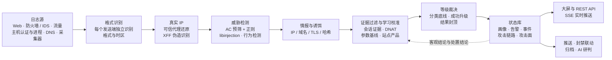

<div align="center">

# netsa

### 开源的网络安全态势感知与攻击面分析平台

**一个二进制，把 Web、防火墙 / IDS、流量、主机与 DNS 日志，变成可溯源、可处置、会自我纠错的安全态势。**<br>
不需要 Elasticsearch、Kafka 或数据库，内网离线可用，5 分钟跑起来。

[](https://github.com/sreyun/netsa/actions/workflows/ci.yml)
[](https://github.com/sreyun/netsa/tags)
[](LICENSE)


[](https://github.com/sreyun/netsa/stargazers)
[](https://github.com/sreyun/netsa/commits/master)

**简体中文** · [English](docs/i18n/README.en.md) · [繁體中文](docs/i18n/README.zh-TW.md) · [日本語](docs/i18n/README.ja.md) · [한국어](docs/i18n/README.ko.md) · [Español](docs/i18n/README.es.md) · [Français](docs/i18n/README.fr.md) · [Deutsch](docs/i18n/README.de.md) · [Русский](docs/i18n/README.ru.md)

[快速开始](#快速开始) · [界面预览](#界面预览) · [为什么选择-netsa](#为什么选择-netsa) · [核心能力](#核心能力) · [工作原理](#工作原理) · [支持的日志](#支持的日志) · [常见问题](#常见问题) · [文档](#文档)

</div>


<div align="center">

| 50+ | 87 + libinjection | 261 | ~46 万条/秒 | 0 |
|:---:|:---:|:---:|:---:|:---:|
| 自动识别的日志格式 | 特征规则 + 语法分析 | 国产 OA / 中间件漏洞接口签名 | 单机端到端吞吐 | 外部依赖组件 |

</div>

## 快速开始

**一条命令体验**（自带攻击日志模拟器，大屏实时滚动）：

```bash
git clone https://github.com/sreyun/netsa.git && cd netsa
docker compose -f docker-compose.demo.yml up -d --build
```

打开 <http://localhost:8080>，账号 `admin`，密码 `Netsa@demo2026`。

**生产部署**：

```bash
git clone https://github.com/sreyun/netsa.git && cd netsa
docker compose pull && docker compose up -d
```

- 访问 `http://<服务器IP>:8080`，初始密码在日志中：`docker compose logs netsa | grep 初始密码`，首次登录后须修改；
- 默认读取宿主机 `/var/log/nginx` 与 `/var/log`；网络设备的 syslog 发送到 `<服务器IP>:5514`（UDP / TCP）；
- 固定版本、修改端口或启用告警归档：`cp .env.example .env` 后按注释修改；Windows PowerShell 5.1 请逐行执行命令，用 `Select-String` 代替 `grep`。

升级回滚、内网离线部署和常见问题见[部署指南](docs/deployment.md)。

**不部署，直接分析已有日志**：

```bash
go build -o bin/netsa ./cmd/netsa
./bin/netsa analyze /var/log/nginx/access.log* /var/log/ufw.log -o report.json
./bin/netsa analyze -listen :8080 access.log    # 分析后打开大屏
```

## 界面预览

| 安全评估与处置建议 | 攻击面分析 |
|---|---|
|  |  |
| **事件处置与处置时限** | **自学习与自我纠错** |
|  |  |

截图来自内置模拟器生成的演示数据，其中的 IP 与站点均为模拟，可用上面的演示环境自行体验。

## 为什么选择 netsa

### 和常见的自建方案相比

| | 日志平台 + 自写规则（如 ELK） | 主机安全平台（多组件） | **netsa** |
|---|---|---|---|
| 部署 | 搜索集群 + 采集 + 看板，多组件运维 | 管理端 + 索引 + 看板 + 每台主机装代理 | **单个二进制 / 一个容器**，地图与定位库内置 |
| 接入日志 | 每种格式写解析规则 | 以主机日志为主 | **50+ 格式自动识别**，每个发送端独立识别格式与时区 |
| 告警质量 | 规则命中即告警 | 规则命中即告警 | **证据复核**：响应基线、会话证据、兜底页面识别，排除“表面成功” |
| 国产生态 | 需要自己写 | 需要自己写 | **261 条国产 OA / 中间件漏洞接口签名**，注明产品与 CVE / CNVD |
| 越用越准 | 靠人维护白名单 | 靠人维护白名单 | **自学习 + 自我纠错闭环**，没有人工结论也能发现自己学错了 |
| 内网离线 | 视组件而定 | 视组件而定 | **完全离线可用**，关闭在线溯源即可 |

### 你会喜欢的细节

- **告警可信**：已拦截的攻击不会被标成“严重”，真正利用成功的不会被漏掉；等级由统一裁决决定，防火墙“放行”、响应 200、多次失败后登录成功都要再用证据复核。
- **认得国产 OA 和中间件**：致远、泛微、用友、通达、蓝凌、万户、帆软、亿赛通、若依、Nacos、APISIX，以及深信服、锐捷、海康、大华等 42 个产品；正常业务在用的漏洞接口自动学习，不会一直刷告警。
- **防火墙与 Web 日志联动**：Web 攻击之后内网主机连接攻击者、或连接攻击载荷里写着的回连地址，直接判为失陷迹象。
- **能溯源到城市，能关联到团伙**：还原 CDN 与代理背后的真实 IP，识别 XFF 伪造；同一工具指纹、同一 OAST 关联标识、TLS 指纹、诱饵线索把轮换出口的同一攻击者归并到一起；资产攻击链路把一台服务器从被扫描到被控制、横向移动的过程按时间串起来。
- **会自我纠错的自学习**：从分析员的结论中学习；没有人工结论时，用成功证据、攻击后回连、诱饵命中、授权扫描登记等客观结论核实自己与 AI 的判断。学错了自动撤销、回溯修正已经产生的事件，纠错本身错了也能自动恢复；已经结束的低风险事件自动归档，待处置列表只留真正需要处理的。
- **AI 研判可选、可评估**：支持 OpenAI 兼容接口与 Anthropic Messages 接口，内网 vLLM、云端模型都能接入；按人工结论与客观结论统计模型一致率，模型误判多了自动收紧它的权限。
- **安全运营闭环**：事件聚合与处置时限、误报抑制、授权扫描登记、钉钉 / 企业微信 / 飞书推送、封禁名单联动、原始日志留存与一键取证包、周报月报、等保 2.0 自查、防篡改审计链。
- **一个搜索框直达一切**：`Ctrl+K` 输入 IP、事件编号、资产、站点、规则或攻击类型，按类别分组、键盘直达攻击源画像、事件、攻击链路与攻击活动，搜不到时一键转到告警与原始日志检索。
- **单机就够快**：开发机（i7-10700，16 线程）端到端约 46 万条/秒；Aho-Corasick 预筛让正常请求基本不必执行正则，检测约 3µs/条；画像数与检测窗口都有硬上限，扫描洪峰下内存可控。

### 适合谁

- **中小企业与政企单位**：没有专职 SOC，需要一个装上就能看懂的态势大屏与处置清单；
- **等保与合规场景**：原始日志留存、哈希链防篡改、审计、周报月报与等保 2.0 自查；
- **IDC、云上业务与对外网站**：大量背景扫描中找出真正打到服务、真正成功的攻击；
- **安全团队与蓝队**：攻击链路、ATT&CK 映射、同源关联与诱饵，快速研判与溯源。

## 核心能力

| 模块 | 能力 |
|---|---|
| [日志采集](docs/log-sources.md) | 实时跟踪文件（通配符、logrotate 轮转）、批量分析（含 `.gz`）、Syslog UDP / TCP / TLS（可双向认证）、[NetFlow / sFlow / IPFIX 采集](docs/log-sources.md#流量日志zeeknetflow--sflow-与云抗-d-服务)；发送端识别、白名单、限速与断流告警 |
| [攻击检测](docs/detection.md) | SQL 注入、XSS、命令执行、Log4Shell、SSRF、XXE、反序列化、WebShell、已知漏洞利用等特征规则，部分规则改编自 OWASP CRS；[libinjection 语法分析](docs/detection.md#语法分析libinjection)；[国产 OA、中间件漏洞接口签名](docs/detection.md#国产-oa中间件漏洞接口签名)；CC、暴力破解、撞库、接口遍历、端口扫描、WebShell 行为画像、数据外传、横向移动、带宽型 DDoS 等行为检测；多轮解码对抗常见绕过 |
| [结果研判](docs/detection.md#研判复核用证据排除表面成功) | 按响应与会话证据区分已拦截、失败、未拦截、疑似成功；排除单页应用兜底页、统一错误页、未到达服务的“放行”、长连接重连、页面资源加载等表面现象 |
| [主机与 DNS 检测](docs/log-sources.md#主机认证日志与-dns-日志) | SSH / RDP / VPN 暴力破解与破解成功、密码喷洒、日志被清除、新建账号与提权、[账号盗用](docs/detection.md#账号盗用)；[主机进程检测](docs/detection.md#主机进程检测)（Web 进程执行命令、反弹 Shell、凭证窃取、持久化）；DNSLog 带外回连、DNS 隧道、DGA、矿池域名 |
| [攻击源溯源](docs/traceability.md) | 融合 ip2region、MaxMind、ip-api、rDNS、RDAP / WHOIS，支持内网自定义网段；同源关联按网段、工具指纹、攻击手法找出疑似同一团伙 |
| [资产攻击链路](docs/detection.md#资产攻击链路) | 以站点 / 主机为中心串起侦察、利用、突破、植入、控制、横向、窃取、影响，每一步注明证据、来源与 ATT&CK 技术，研判是否失陷并给出处置建议 |
| [态势大屏](docs/deployment.md#演示环境) | 世界 / 中国双视图攻击地图，可下钻到省和地市；外部对内与内部对外的实时飞线、告警推送；KPI、趋势、分布图均可点击下钻 |
| [攻击面分析](docs/log-sources.md#未做-dnat-映射的端口探测) | 梳理对外服务，发现源码、密钥、备份泄露与管理接口暴露；结合 DNAT 映射与防火墙会话证据，过滤打不到任何服务的背景扫描 |
| [安全评估与失陷研判](docs/detection.md#安全评估与失陷研判) | 七个维度打分并给出 A~E 总评与 P0~P3 处置建议；C2 心跳、恶意 TLS 指纹、攻击载荷落地、[被攻击后回连](docs/detection.md#防火墙与-web-日志联动被攻击后回连)；MITRE ATT&CK 矩阵 |
| [自学习与 AI 研判](docs/self-learning.md) | 规则级、目标级与情报源准确率自动校准；从日志学习内网网段、攻击源、攻击活动、[参数正常取值与站点产品](docs/self-learning.md#参数的正常取值与站点产品)；[自我纠错闭环](docs/self-learning.md#自我纠错闭环)：客观核实、纠错回溯、自动归档；AI 研判支持 OpenAI 兼容与 Anthropic 接口 |
| [事件处置与推送](docs/operations.md#事件处置与误报抑制) | 告警自动聚合为事件，指派、处置时限与超时提醒；误报抑制；[授权扫描登记](docs/detection.md#授权扫描登记)；[钉钉 / 企业微信 / 飞书推送](docs/operations.md#告警推送钉钉--企业微信--飞书)；导出 nginx、iptables、ipset 等封禁列表 |
| [留存、合规与审计](docs/operations.md#原始日志留存与检索) | 原始日志按小时压缩留存，哈希链防篡改；[PostgreSQL 长期归档](docs/operations.md#告警归档可选postgresql)（可选）；周报月报、等保 2.0 自查；[三种角色、双因素认证与防篡改审计链](docs/operations.md#登录账号与审计)；Prometheus 指标 |

## 工作原理



几个关键设计：

- **等级只在一处裁决**：规则声明的等级只是建议值，避免各环节各自加减造成同类事件等级不一致。详见[威胁等级判定](docs/detection.md#威胁等级判定)。
- **证据优先于表象**：防火墙“放行”、响应 200、多次失败后登录成功，都要再用会话、响应基线和账号线索复核。
- **学习有边界，也会认错**：降低等级的校准只从人的结论学习，每次最多一级，利用成功仍判严重；会隐藏告警的误报抑制必须人工采纳。学到的东西被客观结论推翻时自动撤销，并回溯修正已经产生的事件。
- **压力下不失控**：解析与检测并行、按批入库，画像数和检测窗口都有硬上限，单条畸形日志不影响服务；队列积压和丢弃都有监控指标。

## 支持的日志

| 类型 | 格式 |
|---|---|
| **Web** | nginx / Tengine / OpenResty / Apache（combined、main、vhost）、任意自定义 `log_format`、nginx JSON、APISIX、Kong、Nginx Proxy Manager、Caddy、Traefik、Elastic ECS、IIS W3C |
| **WAF** | nginx / Tengine / OpenResty 错误日志中的 ModSecurity、naxsi 拦截与限流，ModSecurity JSON 审计日志，OpenResty Lua WAF |
| **防火墙** | iptables、UFW、firewalld、nftables、pfSense / OPNsense、Windows 防火墙、Cisco ASA / FTD、Palo Alto、FortiGate、华为 USG、H3C、深信服、山石，以及华为、H3C、深信服的攻击防范日志 |
| **IDS / IPS** | Suricata EVE JSON、Snort fast alert、FortiGate IPS / UTM 等设备威胁日志 |
| **主机与 VPN 认证** | Linux `auth.log` / `secure`、Windows 安全事件（NXLog、Winlogbeat、Snare）、FortiGate / Cisco / OpenVPN、SQL Server 登录 |
| **DNS** | BIND、dnsmasq、CoreDNS、Windows DNS、Zeek、Suricata DNS |
| **流量** | Zeek（conn / http / ssl / files，TSV 或 JSON）、NetFlow v5 / v9、IPFIX、sFlow v5（UDP 采集）、云抗 D 服务的攻击事件 |
| **主机进程（EDR / HIDS）** | Sysmon（Winlogbeat / NXLog / Elastic Agent）、Windows 4688、Elastic Defend（ECS）、Linux auditd、Wazuh 告警 |
| **应用登录与蜜罐** | 业务系统、统一身份认证 / SSO 的 JSON 登录日志，OpenCanary 蜜罐日志 |
| **容器与采集器** | Docker json-file、Fluent Bit / Fluentd、Filebeat / Logstash / Vector、containerd / CRI-O，自动拆开后识别原始日志 |

接入方法见[日志接入](docs/log-sources.md)；接入后在大屏“数据源”页查看识别结果和解析失败样例。

## 常见问题

**日志会离开我的网络吗？** 不会。所有分析都在本机完成；在线溯源（ip-api、RDAP）与 AI 研判都是可选项，关闭后完全离线运行。接入外部模型时可开启发送前脱敏（内网地址、口令 / 令牌、手机号、证件号、邮箱）。

**和 WAF 是什么关系？** 互补。netsa 不串在业务链路上，读取 WAF、nginx、防火墙的日志做研判：哪些攻击被拦了、哪些打到了后端、哪些真的成功了，以及攻击者之后又做了什么。

**需要多少资源？** 单机即可。检测窗口与画像数都有上限，扫描洪峰下内存可控；吞吐见上面的性能数据，更大的规模可按数据源拆分部署。

**误报多怎么办？** 先看告警里的证据与“需核实”说明；把事件处置为误报后，自学习会生成抑制建议、自动校准反复误报的规则与目标；内部漏洞扫描可一键登记为授权扫描。

**支持哪些部署方式？** Docker / Docker Compose（amd64、arm64）、直接运行二进制、内网离线镜像包，详见[部署指南](docs/deployment.md)。

## 文档

| 文档 | 内容 |
|---|---|
| [部署指南](docs/deployment.md) | 生产部署、`.env` 变量、升级回滚、内网离线、演示环境、从源码运行 |
| [日志接入](docs/log-sources.md) | Web、防火墙、认证、DNS、流量（Zeek、NetFlow / sFlow、云抗 D）、主机进程、应用登录接入，syslog 发送端管理，时区，DNAT 与会话证据 |
| [检测与研判](docs/detection.md) | 威胁等级判定、研判复核、攻击活动与资产攻击链路、数据窃取与横向移动、诱饵、主机进程检测、账号盗用、威胁评分、安全评估与失陷研判 |
| [攻击源溯源](docs/traceability.md) | 多源定位、内网网段、定位库热更新、同源关联分析 |
| [自学习与 AI 研判](docs/self-learning.md) | 自动生效的范围与边界、自我纠错闭环、行为基线、合规自检、外部模型配置与模型适配 |
| [安全运营](docs/operations.md) | 事件处置、告警推送、原始日志、资产漏洞、报表合规、账号审计、监控指标、告警归档 |
| [配置参考](docs/configuration.md) | 常用配置项与运行注意事项 |
| [API](docs/api.md) | REST 接口一览 |
| [对接外部系统](docs/integrations.md) | LDAP / OIDC 单点登录、SIEM 转发、联动封禁、工单与处置剧本、STIX / TAXII / MISP 与文本情报、Sigma 与签名规则包 |
| [开发与发布](docs/development.md) | 本地测试、代码结构、镜像构建与发布 |
| [能力评估与路线图](docs/roadmap.md) | 按攻击链路评估识别、定位、溯源能力，缺口与分步计划 |
| [更新记录](docs/CHANGELOG.md) | 影响使用的变化 |

## 开发

需要 Go 1.26 及以上（发布版本使用 Go 1.27 构建），纯 Go 实现，无 CGO。

```bash
go build -o bin/netsa ./cmd/netsa
gofmt -l internal cmd     # 必须没有输出
go vet ./...
go test ./...
```

竞态测试依赖 C 编译器，本机没有 gcc 时可以在容器里运行：

```bash
docker run --rm -v "$PWD":/src -w /src golang:1.27-alpine sh -c 'apk add --no-cache gcc musl-dev && CGO_ENABLED=1 go test -race -short ./...'
```

代码结构和发布流程见[开发与发布](docs/development.md)。

## 参与贡献

欢迎提交 Issue 和 Pull Request，尤其欢迎：

- 新的日志格式样例（请先脱敏），以及识别失败或解析错误的反馈；
- 新的检测规则，以及带样例的误报、漏报报告；
- 文档改进和实际部署经验。

提交代码前请先通过上面的检查，CI 还会运行竞态测试和 `govulncheck`。

## Star 趋势

如果 netsa 帮你发现了一次真实的攻击，或者省下了一套日志平台的运维，请点一个 **Star**，让更多需要它的人看到。

[](https://star-history.com/#sreyun/netsa&Date)

## 许可证

本项目采用 [Apache License 2.0](LICENSE) 发布：可以自由地用于商业目的、修改与再分发，只需保留版权声明、许可文本与 [NOTICE](NOTICE) 文件。

- 软件按「现状」提供，不附带任何明示或暗示的担保；
- 许可不授予商标使用权，`netsa` 名称与标识不包含在授权范围内；
- 第三方依赖遵循各自许可，完整列表见 `go.mod` 与 `go.sum`；部分检测规则改编自 [OWASP Core Rule Set](https://coreruleset.org)（Apache-2.0），国产 OA、中间件漏洞接口签名提取自 [nuclei-templates](https://github.com/projectdiscovery/nuclei-templates)（MIT），见 [NOTICE](NOTICE)。

规则与情报订阅、部署交付、等保测评支撑等商业服务由维护方另行提供，不影响开源版依据 Apache-2.0 的使用权利。
