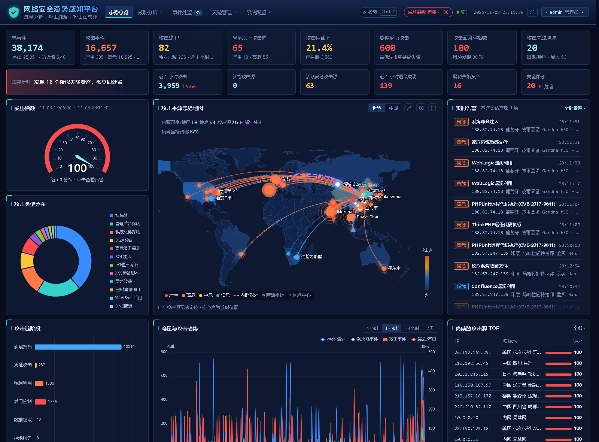
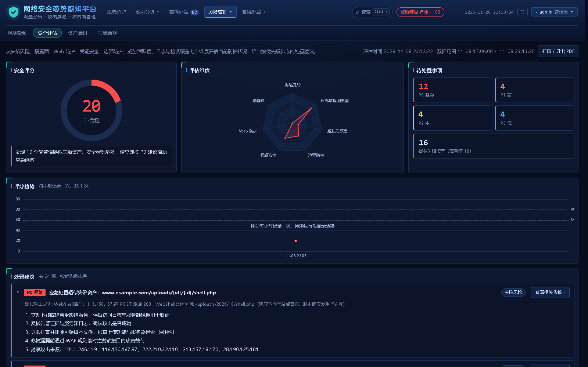
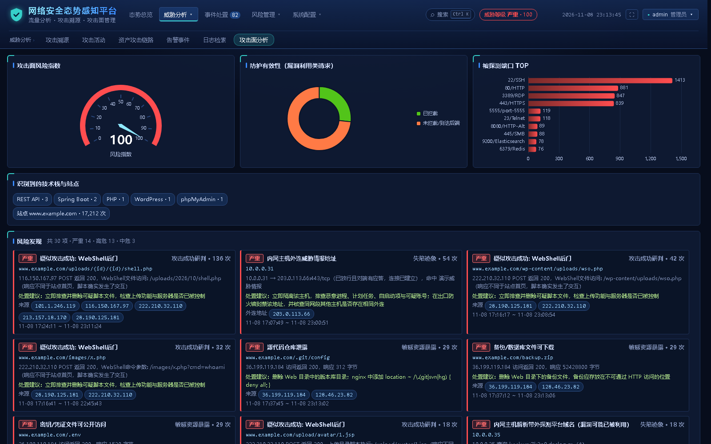
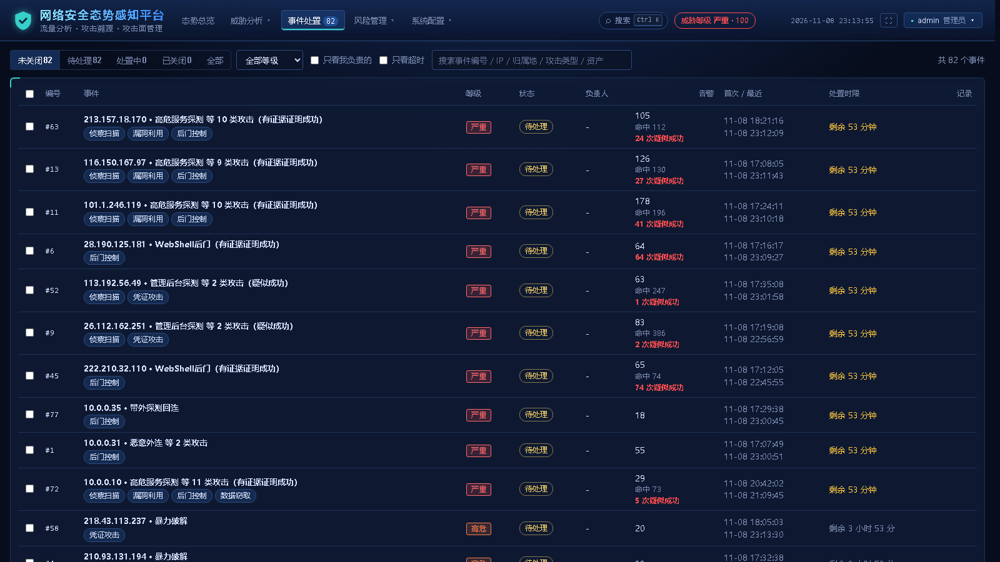
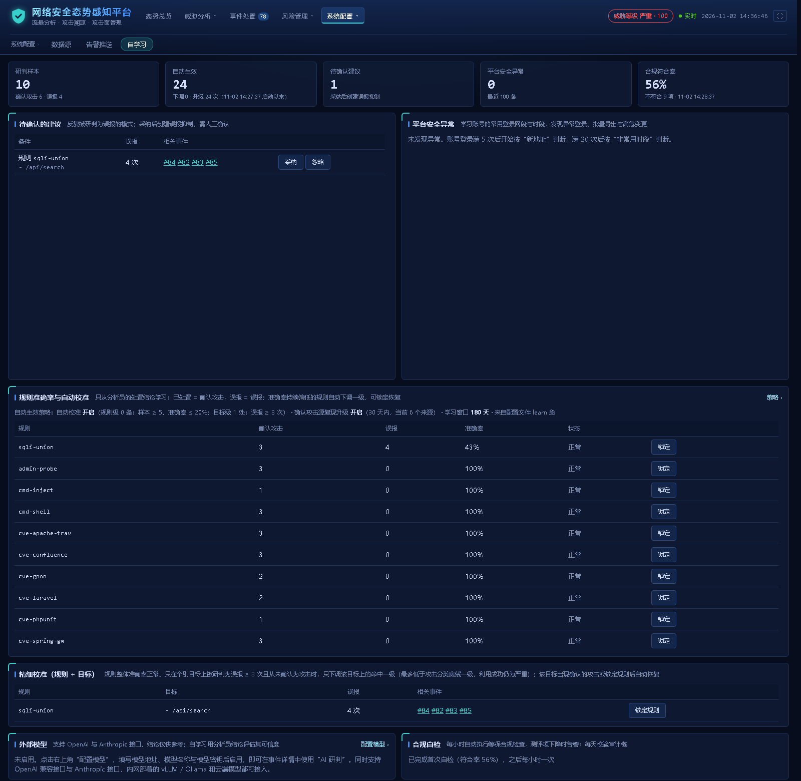

<div align="center">

# netsa

**オープンソースのネットワークセキュリティ状況把握・攻撃対象領域分析プラットフォーム**

nginx、ファイアウォール / IDS、ホスト認証、DNS のログを、追跡でき、対処でき、学習し続けるセキュリティ状況へ。<br>
単一バイナリですぐに使え、閉域網でのオフライン運用にも対応します。

[](https://github.com/sreyun/netsa/actions/workflows/ci.yml)
[](https://github.com/sreyun/netsa/tags)


[简体中文](../../README.md) · [English](README.en.md) · [繁體中文](README.zh-TW.md) · **日本語** · [한국어](README.ko.md) · [Español](README.es.md) · [Français](README.fr.md) · [Deutsch](README.de.md) · [Русский](README.ru.md)

[クイックスタート](#クイックスタート) · [画面プレビュー](#画面プレビュー) · [主な機能](#主な機能) · [動作の仕組み](#動作の仕組み) · [対応ログ](#対応ログ) · [ドキュメント](#ドキュメント)

</div>



## netsa を選ぶ理由

- **依存なし、ワンステップでデプロイ**：Go の単一バイナリに、フロントエンド、世界地図と中国の省・市地図、オフライン位置情報データベースをすべて内蔵。Elasticsearch、Kafka、データベースは不要です。Docker イメージは amd64 と arm64 を提供し、オンライン追跡をオフにすれば隔離ネットワークで完全にオフライン動作します。
- **ログの事前適合は不要**：40 種類以上の形式を自動認識します。nginx / Apache / IIS / Caddy、iptables、Huawei、H3C、FortiGate、Palo Alto、Suricata、Linux と Windows の認証、主要な DNS、Docker や Filebeat などのコレクターのラッパー形式に対応します。
- **正確な検知、信頼できるアラート**：69 件のシグネチャルールと振る舞い検知を備え、レスポンス、セッションの証拠、資産の脆弱性で「見かけ上の成功」を再検証します。重大度は一元的に判定され、ブロック済みの攻撃が「緊急」とされることはなく、実際に成功した悪用を見逃しません。
- **都市まで追跡し、グループまで関連付け**：CDN やプロキシの背後にある実 IP を復元し、XFF の偽装や CDN を迂回した直接接続を識別します。複数の位置情報ソースを照合して信頼度を示し、同一ソース相関分析で同じ攻撃者と疑われる他の IP を見つけます。
- **使うほど正確に**：アナリストの判断結果から学習します。誤検知を繰り返すルールやエンドポイントは自動で格下げされ、確認済みの攻撃者が再び現れると自動で格上げされます。AI トリアージは OpenAI と Anthropic の両方の API に対応し、社内の vLLM もクラウドモデルも接続できます。モデルの違いに自動で適応し、アナリストの判断結果でモデルの信頼性を評価します。
- **セキュリティ運用のループを完結**：インシデントの集約と対応期限、誤検知の抑制、DingTalk / WeCom / Feishu への通知、資産と脆弱性の関連付け、生ログの保管とフォレンジック、週次・月次レポート、MLPS 2.0（中国の等級保護制度）の自己点検、改ざん検知可能な監査チェーン。
- **単一マシンで十分に高速**：開発機（i7-10700、16 スレッド）でエンドツーエンド約 46 万件/秒。Aho-Corasick の事前フィルタにより通常のリクエストはほぼ正規表現を実行せず、検知は約 3µs/件です。

## クイックスタート

### コマンド 1 つで体験（攻撃ログのシミュレーター付き）

```bash
git clone https://github.com/sreyun/netsa.git
cd netsa
docker compose -f docker-compose.demo.yml up -d --build
```

ブラウザで <http://localhost:8080> を開き、ユーザー名 `admin`、パスワード `Netsa@demo2026` でログインします。シミュレーターが攻撃ログを生成し続け、ダッシュボードがリアルタイムに更新されます。

### 本番デプロイ

```bash
git clone https://github.com/sreyun/netsa.git
cd netsa
docker compose pull
docker compose up -d
```

- `http://<サーバーIP>:8080` にアクセスします。初期パスワードはログに出力されます：`docker compose logs netsa | grep 初始密码`（`初始密码` はログに出力される文字列で、「初期パスワード」の意味です）。初回ログイン後に変更が必要です。
- 既定ではホストの `/var/log/nginx` と `/var/log` を読み取ります。ネットワーク機器の syslog は `<サーバーIP>:5514`（UDP / TCP）へ送信します。
- バージョンの固定、ポートの変更、アラートのアーカイブが必要な場合は、先に `cp .env.example .env` を実行し、コメントに従って編集します。
- Windows PowerShell 5.1 は `&&` と `grep` に対応していません。コマンドを 1 行ずつ実行し、`grep` の代わりに `Select-String` を使ってください。

アップグレードとロールバック、オフライン環境へのデプロイ、よくある問題は[デプロイガイド](../deployment.md)を参照してください。

### デプロイせず既存のログを分析

```bash
go build -o bin/netsa ./cmd/netsa
./bin/netsa analyze /var/log/nginx/access.log* /var/log/ufw.log -o report.json
./bin/netsa analyze -listen :8080 access.log    # 分析後にダッシュボードを開く
```

## 画面プレビュー

| セキュリティ評価と対応の推奨事項 | 攻撃対象領域の分析 |
|---|---|
|  |  |
| **インシデント対応と対応期限** | **自己学習と自動キャリブレーション** |
|  |  |

スクリーンショットは中国語の Web 画面で、内蔵シミュレーターが生成したデモデータを表示しています。IP とサイトはすべて架空のものです。上記のデモ環境でご自身でも試せます。

## 主な機能

| モジュール | 機能 |
|---|---|
| [ログ収集](../log-sources.md) | ファイルのリアルタイム追跡（ワイルドカード、logrotate のローテーション）、バッチ分析（`.gz` を含む）、Syslog UDP / TCP / TLS（相互認証可）；送信元の識別、許可リスト、レート制限、ログ途絶アラート |
| [攻撃検知](../detection.md) | SQL インジェクション、XSS、コマンド実行、Log4Shell、SSRF、XXE、デシリアライゼーション、WebShell、既知の脆弱性の悪用などのシグネチャルール；CC、ブルートフォース、クレデンシャルスタッフィング、API の列挙、ポートスキャンなどの振る舞い検知；多段デコードで一般的な回避に対抗 |
| [結果の判定](../detection.md#研判复核用证据排除表面成功) | レスポンスとセッションの証拠で、ブロック済み、失敗、未ブロック、成功の疑いを区別；シングルページアプリのフォールバックページ、統一エラーページ、サービスに到達していない「許可」などの見かけを排除 |
| [ホストと DNS の検知](../log-sources.md#主机认证日志与-dns-日志) | SSH / RDP / VPN のブルートフォースと侵入成功、パスワードスプレー、ログの消去、アカウント作成と権限昇格；DNSLog の帯域外コールバック、DNS トンネル、DGA、マイニングプールのドメイン |
| [攻撃元の追跡](../traceability.md) | ip2region、MaxMind、ip-api、rDNS、RDAP / WHOIS を統合し、内部のカスタムサブネットの位置指定にも対応；同一ソース相関でサブネット、ツールの指紋、攻撃手法から同じグループと疑われる IP を発見 |
| [状況ダッシュボード](../deployment.md#演示环境) | 世界 / 中国の 2 つの攻撃マップで省・市までドリルダウン；攻撃線のリアルタイム表示とアラート通知；KPI、トレンド、分布グラフから攻撃元やアラートへドリルダウン |
| [攻撃対象領域の分析](../log-sources.md#未做-dnat-映射的端口探测) | 公開サービスを整理し、ソースコード、鍵、バックアップの漏えいや管理インターフェースの露出を発見；DNAT マッピングとファイアウォールのセッション証拠で、どのサービスにも届かないバックグラウンドスキャンを除外 |
| [セキュリティ評価と侵害の判定](../detection.md#安全评估与失陷研判) | 7 つの観点で採点し、A〜E の総合評価と P0〜P3 の推奨事項を提示；内部ホストから脅威インテリジェンスのアドレスへの接続、C2 ビーコンの検知；MITRE ATT&CK マトリクス |
| [自己学習と AI トリアージ](../self-learning.md) | ルール単位とターゲット単位の自動キャリブレーション、確認済み攻撃元の再出現時の格上げ、学習ウィンドウ（ポリシーは画面で調整可能）；AI トリアージは OpenAI / Anthropic API と vLLM に対応し、モデルの違いに自動で適応、自組織の類似事例を添付し、モデルとアナリストの判断の一致率を集計 |
| [インシデント対応と通知](../operations.md#事件处置与误报抑制) | アラートをインシデントへ自動集約し、担当者割り当て、対応期限、期限超過の通知に対応；誤検知の抑制；[DingTalk / WeCom / Feishu 通知](../operations.md#告警推送钉钉--企业微信--飞书)（重複排除、統合、レート制限）；nginx、iptables、ipset などのブロックリストを出力 |
| [保管、コンプライアンス、監査](../operations.md#原始日志留存与检索) | 生ログを 1 時間単位で圧縮保管し、ハッシュチェーンで改ざんを防止；[PostgreSQL への長期アーカイブ](../operations.md#告警归档可选postgresql)（任意）；週次・月次レポート、MLPS 2.0 の自己点検；[3 つのロール、二要素認証、改ざん検知可能な監査チェーン](../operations.md#登录账号与审计)；Prometheus メトリクス |

## 動作の仕組み

```text
ログソース      nginx · ファイアウォール / IDS · ホスト認証 · DNS · コンテナとコレクター
   │            ファイル追跡 / バッチ分析 / Syslog（UDP · TCP · TLS）
   ▼
形式の識別      データソースと送信元ごとに形式とタイムゾーンを個別に識別
   ▼
実 IP           信頼できるプロキシに基づき送信元を復元、XFF 偽装と CDN 迂回を記録
   ▼
脅威検知        シグネチャルール（AC 事前フィルタ + 正規表現）+ 振る舞い検知（時間枠、メモリ上限あり）
   ▼
証拠フィルタ    セッション証拠と DNAT マッピングでサービス未到達の探査を除外、誤検知の抑制を適用
   ▼
学習による調整  アナリストの判断で誤検知を繰り返すヒットを格下げ、確認済み攻撃元を格上げ（learn）
   ▼
重大度の判定    分類の下限、成功時の格上げ、結果による上限で最終的な重大度を一元決定（risk）
   ▼
状態ストア      攻撃者プロファイル · アラート · インシデント · 攻撃対象領域 · 時系列 · スナップショット永続化
   │
   ├── Web ダッシュボードと REST API（SSE によるリアルタイム通知）
   ├── DingTalk / WeCom / Feishu / Webhook
   ├── 生ログの保管 · PostgreSQL アーカイブ（任意）
   └── AI トリアージ（任意、結論をインシデントの対応記録へ書き込み）
```

設計の要点：

- **重大度は 1 か所で判定**：ルールで宣言した重大度は推奨値にすぎません。各段階が個別に加減して同種のイベントの重大度がばらつくのを防ぎます。詳しくは[重大度の判定](../detection.md#威胁等级判定)を参照してください。
- **見かけより証拠を優先**：ファイアウォールの「許可」、レスポンス 200、失敗を繰り返した後のログイン成功は、いずれもセッション、レスポンスの基準値、アカウントの手がかりで再検証します。
- **学習には境界がある**：人の判断からのみ学習します。自動調整は 1 回につき最大 1 段階で、悪用の成功は引き続き「緊急」と判定します。アラートを隠す誤検知の抑制は人による採用が必須です。AI の結論は学習サンプルにならず、自動対応も行いません。
- **高負荷でも制御を失わない**：解析と検知は並列で実行してバッチで保存し、プロファイル数と検知ウィンドウには厳格な上限があります。不正な形式のログ 1 行がサービスに影響することはなく、キューの滞留と破棄はメトリクスで監視できます。

## 対応ログ

| 種類 | 形式 |
|---|---|
| **Web** | nginx / Apache（combined、main、vhost）、任意のカスタム `log_format`、nginx JSON、Caddy、Traefik、Elastic ECS、IIS W3C |
| **ファイアウォール** | iptables、UFW、firewalld、nftables、pfSense / OPNsense、Windows ファイアウォール、Cisco ASA / FTD、Palo Alto、FortiGate、Huawei USG、H3C、Sangfor、Hillstone |
| **IDS / IPS** | Suricata EVE JSON、Snort fast alert、FortiGate IPS / UTM などの機器の脅威ログ |
| **ホストと VPN の認証** | Linux `auth.log` / `secure`、Windows セキュリティイベント（NXLog、Winlogbeat、Snare）、FortiGate / Cisco / OpenVPN、SQL Server のログイン |
| **DNS** | BIND、dnsmasq、CoreDNS、Windows DNS、Zeek、Suricata DNS |
| **コンテナとコレクター** | Docker json-file、Fluent Bit / Fluentd、Filebeat / Logstash / Vector、containerd / CRI-O（自動で展開して元のログを識別） |

接続方法は[ログの接続](../log-sources.md)を参照してください。接続後はダッシュボードの「データソース」ページで、識別結果と解析失敗のサンプルを確認できます。

## ドキュメント

以下の詳細ドキュメントは簡体字中国語で書かれています。

| ドキュメント | 内容 |
|---|---|
| [デプロイガイド](../deployment.md) | 本番デプロイ、`.env` 変数、アップグレードとロールバック、オフライン環境、デモ環境、ソースからの実行 |
| [ログの接続](../log-sources.md) | Web、ファイアウォール、認証、DNS の接続、syslog 送信元の管理、タイムゾーン、DNAT とセッション証拠 |
| [検知と判定](../detection.md) | 重大度の判定、結果の再検証、脅威スコア、セキュリティ評価と侵害の判定 |
| [攻撃元の追跡](../traceability.md) | 複数ソースの位置情報、内部サブネット、位置情報データベースのホットリロード、同一ソース相関分析 |
| [自己学習と AI トリアージ](../self-learning.md) | 自動適用の範囲と境界、振る舞いのベースライン、コンプライアンス自己点検、外部モデルの設定と適応 |
| [セキュリティ運用](../operations.md) | インシデント対応、アラート通知、生ログ、資産と脆弱性、レポートとコンプライアンス、アカウントと監査、メトリクス、アラートのアーカイブ |
| [設定リファレンス](../configuration.md) | よく使う設定項目と運用上の注意点 |
| [API](../api.md) | REST API の一覧 |
| [外部システム連携](../integrations.md) | LDAP / OIDC シングルサインオン、SIEM 転送、ファイアウォール連携ブロック、チケットとプレイブック、STIX / TAXII / MISP インテリジェンス、Sigma と署名付きルールパック |
| [開発とリリース](../development.md) | ローカルテスト、コード構成、イメージのビルドとリリース |

## 開発

Go 1.25 以降が必要です（リリース版は Go 1.27 でビルド）。純粋な Go 実装で、CGO は使いません。

```bash
go build -o bin/netsa ./cmd/netsa
gofmt -l internal cmd     # 何も出力されないこと
go vet ./...
go test ./...
```

競合状態のテストには C コンパイラが必要です。手元に gcc がない場合はコンテナで実行できます：

```bash
docker run --rm -v "$PWD":/src -w /src golang:1.27-alpine sh -c 'apk add --no-cache gcc musl-dev && CGO_ENABLED=1 go test -race -short ./...'
```

コード構成とリリース手順は[開発とリリース](../development.md)を参照してください。

## コントリビューション

Issue と Pull Request を歓迎します。特に次のものをお待ちしています：

- 新しいログ形式のサンプル（事前に匿名化してください）、識別の失敗や解析エラーの報告
- 新しい検知ルール、サンプル付きの誤検知・検知漏れの報告
- ドキュメントの改善と実際のデプロイ経験

コードを提出する前に上記のチェックを通してください。CI では競合状態のテストと `govulncheck` も実行します。

netsa が役に立ったら、必要としている人に届くよう **Star** をお願いします。
